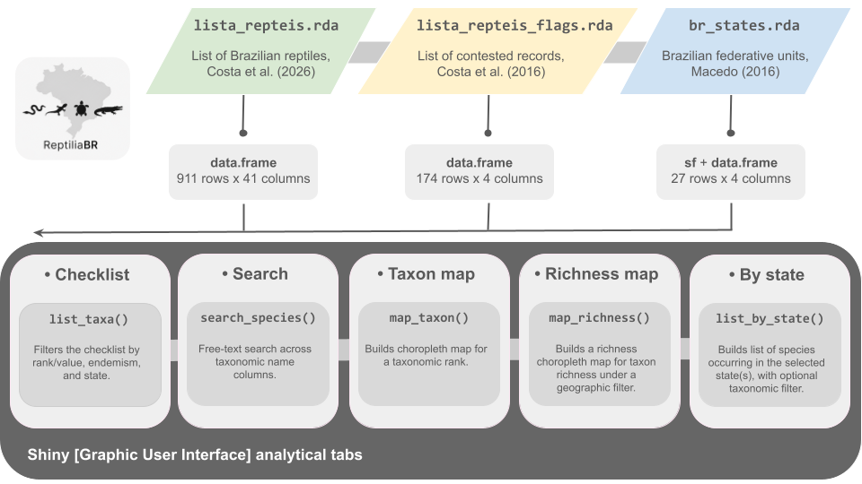

# A tutorial for ReptiliaBR #
ReptiliaBR is an R package that provides a curated taxonomic checklist of Brazilian reptile species (orders Testudines, Crocodylia, and Squamata) together with state-level (Unidade da Federação, UF) occurrence records for all 27 Brazilian states. The package bundles three datasets and eight exported functions that allow users to filter and query the checklist by taxonomic rank or geographic occurrence, to inspect occurrence records that were flagged as doubtful or contested in the source compilation, and to generate static choropleth maps of species richness or of a single taxon's distribution. An optional Shiny application built on the same functions provides an interactive, browser-based interface requiring no R code.

# The guide #  


## Installation

Install remotes if you haven't already

```if (!require("remotes")) install.packages("remotes")```

Install the package directly from the repository

```remotes::install_github("omarentiauspe/ReptiliaBR")```

Or, after downloading file:

```r
install.packages("ReptiliaBR_0.4.0.tar.gz", repos = NULL, type = "source")
```

Requires: `ggplot2`, `sf`, `rlang` (installed automatically as dependencies).

